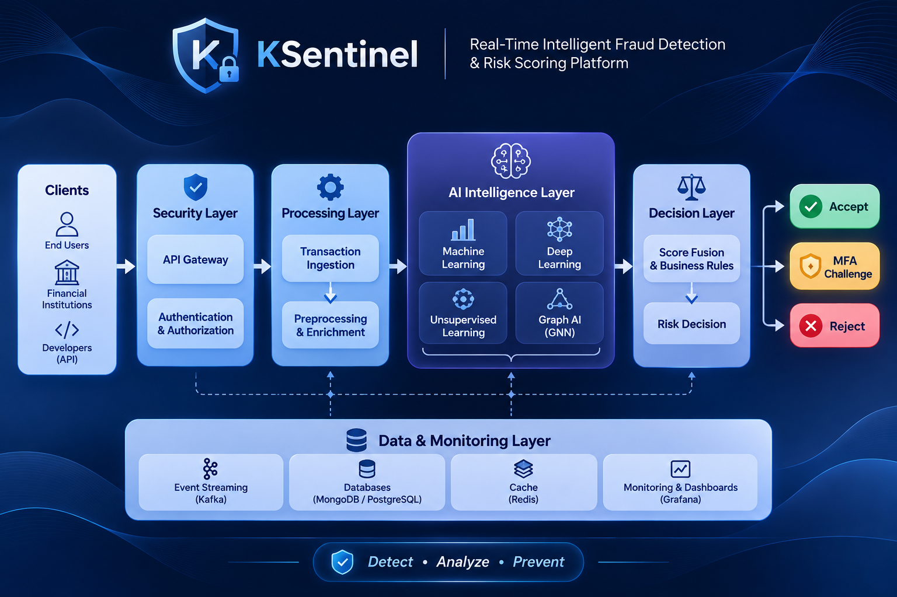

# KSentinel
### Intelligent Real-Time Fraud Detection & Risk Scoring Platform

  <strong>An intelligent platform for analysing transactions, detecting suspicious behaviour and turning model outputs into actionable risk insights.</strong>

  
  
  
  
  
  

  

---

## 1. Project Overview

**KSentinel is an intelligent real-time fraud detection and risk scoring platform** designed to analyse financial transactions, identify potentially fraudulent behaviour and support risk investigation.

Financial fraud is not defined by a single pattern. Suspicious activity can appear as known fraud signatures, unusual transaction behaviour or relationships between accounts and entities. A detection system built around one algorithm may therefore overlook important signals or struggle to adapt to different types of behaviour.

KSentinel addresses this challenge through a multi-model approach. It brings together complementary machine learning, deep learning and graph-based techniques within a broader software platform that connects transaction analysis, AI-driven detection, risk assessment and analyst-facing interfaces.

The project combines several engineering disciplines:

- **Backend engineering** to expose application capabilities and coordinate platform services.
- **Artificial intelligence** to explore different ways of identifying suspicious transactions.
- **Data processing and streaming** to support the movement and handling of transaction-related information.
- **Risk assessment** to bring detection outputs into a consolidated risk-oriented view.
- **Application engineering** to make results accessible through dedicated user interfaces.
- **Security and observability** to support controlled access and operational visibility.

KSentinel was developed as a collaborative academic project at ENIAD during the 2025–2026 academic year.

## 2. The Problem & Our Approach

### Why fraud detection is challenging

Fraud detection involves several technical and operational challenges:

| Challenge | Why it matters |
|---|---|
| **Evolving behaviour** | Fraud patterns can change, making fixed detection rules insufficient on their own. |
| **Class imbalance** | Fraudulent transactions are often much less frequent than legitimate ones, which complicates model training and evaluation. |
| **Subtle anomalies** | Some suspicious transactions do not match previously labelled fraud patterns. |
| **Relational behaviour** | Risk can emerge from relationships between accounts, transactions and other entities, not only from individual transaction attributes. |
| **False positives** | Flagging legitimate activity can create unnecessary investigation workload. |
| **Interpretability** | Analysts need context to understand why a transaction has been flagged. |

### KSentinel's approach

KSentinel explores these challenges through a layered detection and risk-analysis approach:

1. **Transaction analysis** — transaction data is made available to the platform for analysis.
2. **Multi-model detection** — complementary detection approaches examine different characteristics of transaction behaviour.
3. **Risk assessment** — model outputs are brought together in a risk-oriented assessment.
4. **Explainability and investigation** — dedicated interfaces help users inspect suspicious results and supporting information.
5. **Platform operations** — authentication, administration and developer-facing capabilities support the wider application.

The objective is not simply to return a fraud prediction, but to connect detection techniques with a platform designed to support the review of potentially risky activity.

## 3. Platform Architecture

KSentinel is composed of interconnected application and AI components. The architecture separates the main responsibilities of the platform while allowing them to contribute to the overall fraud-analysis workflow.

### Main architectural components

| Component | Responsibility |
|---|---|
| **API & Access Management** | Provides application entry points and handles authentication and controlled access. |
| **Transaction Processing** | Receives and prepares transaction information for analysis. |
| **AI Detection Engine** | Brings together supervised, unsupervised, deep learning and graph-based detection approaches. |
| **Risk Assessment** | Consolidates detection signals into a risk-oriented assessment. |
| **Investigation & Explainability** | Makes suspicious activity and associated explanatory information available for review. |
| **Platform Interfaces** | Provides dedicated workspaces for analysts, administrators and developers. |
| **Audit & Observability** | Supports traceability and visibility into platform activity and operation. |

### Technology responsibilities

The platform combines Java/Spring Boot and Python/FastAPI across its backend and AI-oriented capabilities. React provides the user-facing application, while Kafka is part of the streaming technology stack. Docker supports the infrastructure layer. The data layer uses MongoDB and PostgreSQL, with Redis included for caching.

These technologies serve different responsibilities within the platform; they are not simply a collection of tools in the same application layer.

## 4. Multi-Model Fraud Detection Engine

A central part of KSentinel is its exploration of multiple detection paradigms. Each approach provides a different perspective on transaction behaviour.

### 4.1 Supervised Learning — LightGBM & XGBoost

**Objective:** learn patterns associated with known fraudulent activity from labelled examples.

Supervised learning uses historical examples with known labels to distinguish between transaction classes. Tree-based gradient boosting methods such as LightGBM and XGBoost are explored for their ability to model structured transaction features and capture non-linear relationships.

- **Dataset:** IEEE-CIS Fraud Detection.
- **Methods:** LightGBM and XGBoost.
- **Detection perspective:** recognition of patterns represented in labelled transaction data.

### 4.2 Anomaly Detection — Autoencoder & Isolation Forest

**Objective:** identify transactions that deviate from expected behaviour.

Anomaly detection is relevant when suspicious activity does not necessarily resemble previously labelled fraud. The project explores an Autoencoder-based approach and Isolation Forest to identify unusual patterns in transaction data.

- **Dataset:** PaySim.
- **Methods:** Autoencoder and Isolation Forest.
- **Detection perspective:** deviations from learned or estimated behavioural patterns.

### 4.3 Deep Learning — Hybrid Autoencoder & TabNet

**Objective:** learn complex representations of transaction data.

Deep learning approaches are explored to capture patterns that may be difficult to represent through simpler feature-based methods. The project includes a Hybrid Autoencoder and TabNet as part of this experimental track.

- **Dataset:** PaySim.
- **Methods:** Hybrid Autoencoder and TabNet.
- **Detection perspective:** representation learning and complex relationships among transaction features.

### 4.4 Graph Learning — Message Passing Graph Neural Network

**Objective:** explore suspicious behaviour through relationships between entities.

A transaction does not always tell the whole story in isolation. Graph-based learning represents entities and their relationships so that information can be learned through connected structures. KSentinel explores a Message Passing Graph Neural Network for this relational perspective.

- **Dataset:** PaySim.
- **Method:** Message Passing Graph Neural Network.
- **Detection perspective:** relational patterns involving accounts and connected entities.

### Comparison of detection approaches

| Approach | Models / techniques | Dataset | Main perspective |
|---|---|---|---|
| **Supervised learning** | LightGBM, XGBoost | IEEE-CIS Fraud Detection | Learn from labelled fraud examples. |
| **Anomaly detection** | Autoencoder, Isolation Forest | PaySim | Identify deviations from expected behaviour. |
| **Deep learning** | Hybrid Autoencoder, TabNet | PaySim | Learn complex transaction representations. |
| **Graph learning** | Message Passing GNN | PaySim | Explore relationships between entities. |

The approaches are complementary: they address different views of suspicious behaviour and provide distinct model outputs for the platform's risk-analysis workflow.

## 5. Risk Scoring & Investigation Support

Detection is only one part of a fraud-analysis workflow. A platform must also make the resulting information useful for review and investigation.

KSentinel includes a risk-assessment dimension that brings detection outputs into a consolidated risk-oriented view. The project explores a final score fusion approach to provide an overall signal that can support the review and prioritisation of potentially suspicious transactions.

The investigation-oriented part of the platform complements this assessment by making relevant transaction and AI-related information accessible through dedicated interfaces.

Key capabilities represented in the project include:

- Consolidated risk-oriented assessment.
- Review of suspicious transaction information.
- AI explanation views to support interpretation of detection results.
- Risk-management interfaces.
- Analyst-oriented monitoring and investigation views.

The risk score should be understood as a decision-support signal, not as an automatic proof that a transaction is fraudulent.

## 6. Application Showcase

KSentinel includes several interfaces designed around different platform users and responsibilities.

### Analyst Workspace

The analyst dashboard brings transaction and monitoring information together in a workspace intended to support the review of potentially suspicious activity.

### AI Explainability & Investigation

The AI explanation interface presents information associated with model outputs and supports the interpretation of suspicious results.

### Risk Management

The risk-management interface provides access to the platform's risk-related views and supports the monitoring of risk information.

### Administration

Platform-level administration is available through a dedicated interface.

<strong>View administration dashboard</strong>

### Developer Portal

The developer-facing interface presents the API-oriented side of the platform.

<strong>View developer portal</strong>

### Authentication

Authentication screens illustrate the platform's user access experience.

<strong>View authentication interfaces</strong>

## 7. Experimental Evaluation

The following table presents selected results reported during the project's experiments.

| Experiment | Dataset / evaluation context | AUC | Recall |
|---|---|---:|---:|
| **LightGBM** | IEEE-CIS | **0.97** | 0.75 |
| **Unsupervised Fusion** | PaySim | **0.94** | 0.71 |
| **Deep Learning** | PaySim | **0.99** | **0.96** |
| **GNN** | PaySim | **0.99** | 0.73 |
| **Final Score Fusion** | Project evaluation | **0.98** | 0.79 |

### Interpreting the metrics

- **AUC** measures how well a model distinguishes between classes across classification thresholds.
- **Recall** measures the proportion of actual positive cases identified by the model.

The experiments use different datasets and evaluation settings. Their metrics should therefore not be interpreted as a direct ranking under identical conditions. PaySim is a synthetic mobile-money dataset. These figures describe the project's experimental evaluations; they do not establish production performance on real banking traffic.

## 8. Technology Stack

| Engineering area | Technologies |
|---|---|
| **Backend & APIs** | Java, Spring Boot, Spring Security, Python, FastAPI, Maven |
| **Machine Learning & AI** | LightGBM, XGBoost, TensorFlow, TabNet, Autoencoders, Isolation Forest, Graph Neural Networks |
| **Explainable AI** | SHAP |
| **Frontend** | React, JavaScript, Tailwind CSS, Vite |
| **Streaming & Coordination** | Apache Kafka, ZooKeeper |
| **Databases & Caching** | MongoDB, PostgreSQL, Redis |
| **Containerisation** | Docker |
| **Security** | JWT, OAuth 2.0 |
| **Monitoring & Observability** | Prometheus, Grafana |

## 9. Project Team

KSentinel was developed collaboratively at **ENIAD** as part of the 2025–2026 academic project.

- **Youssra Hamidouche**
- **Najat Id Raho**
- **Ouissal Jouhari**

The platform brings together software engineering, data processing and applied AI in a shared project scope.

## 10. Repository Scope

This repository is a public project showcase containing selected documentation and visual previews of KSentinel. The complete source code is maintained separately.

---

  <strong>KSentinel — Intelligent Real-Time Fraud Detection & Risk Scoring.</strong>

  From transaction signals to risk intelligence.

