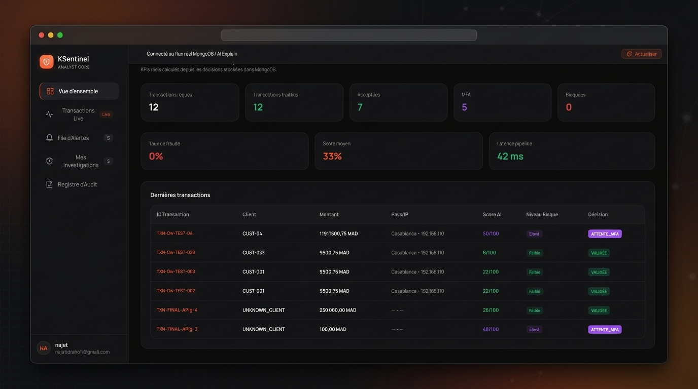
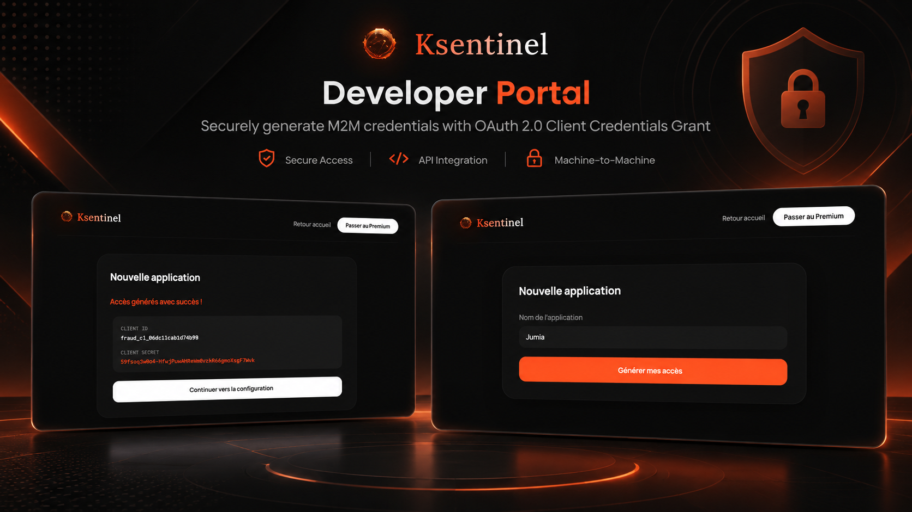
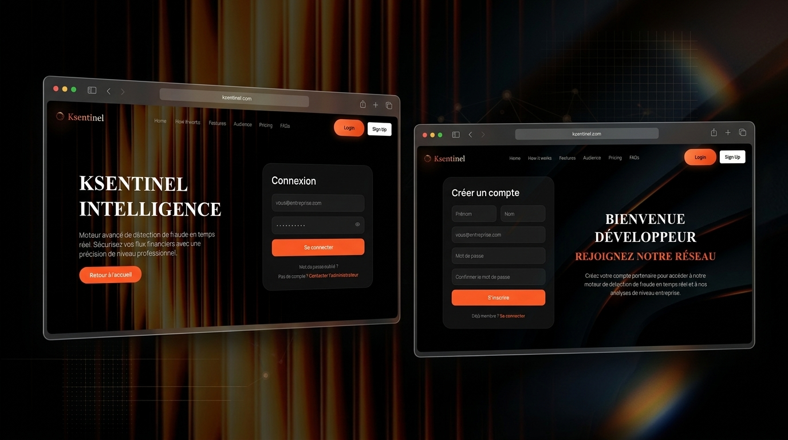

# KSentinel
### Intelligent Fraud Detection & Risk Scoring Platform

  
  
  
  
  
  

> **Detect suspicious transactions. Understand risk. Support investigation.**

KSentinel is a fraud detection platform that analyses financial transactions using complementary machine learning and deep learning approaches. It brings together transaction analysis, risk scoring and explainability to help identify potentially fraudulent activity and give analysts useful context for investigating flagged transactions.

  

## What KSentinel brings together

- **Transaction monitoring** — organise transaction data for fraud analysis and review.
- **Multi-model detection** — evaluate transaction patterns through supervised learning, anomaly detection, deep learning and graph-based learning.
- **Risk scoring** — consolidate detection signals into a risk-oriented assessment.
- **Explainable investigation** — provide information that helps analysts interpret suspicious results.
- **Platform management** — offer dedicated administration, authentication and developer-facing interfaces.
- **Traceability** — support operational visibility through audit-oriented information.

## Architecture

KSentinel connects transaction processing, AI detection and risk assessment in one workflow. Transaction data is prepared for analysis and evaluated by complementary detection approaches. Their outputs contribute to a consolidated risk assessment, which helps prioritise suspicious activity for further investigation. Dedicated interfaces support analysts, administrators and developers as they interact with the platform.

| Component | Responsibility |
|---|---|
| **API & Access Management** | Manages application entry points, authentication and controlled access. |
| **Transaction Processing** | Receives and prepares transaction data for analysis. |
| **AI Detection Engine** | Runs the selected machine learning and deep learning approaches. |
| **Risk Assessment** | Combines detection signals into a risk-oriented result. |
| **Investigation & Explainability** | Presents suspicious activity and supporting explanations for review. |
| **Audit & Reporting** | Supports traceability and operational visibility. |

## AI detection engine

The detection engine explores four complementary approaches. Each addresses a different view of transaction behaviour.

| Approach | Models / techniques | Dataset | Detection perspective |
|---|---|---|---|
| **Supervised learning** | LightGBM, XGBoost | IEEE-CIS Fraud Detection | Learns patterns from labelled transaction examples. |
| **Anomaly detection** | Autoencoder, Isolation Forest | PaySim | Identifies transactions that deviate from learned behaviour. |
| **Deep learning** | Hybrid Autoencoder, TabNet | PaySim | Learns more complex representations of transaction data. |
| **Graph learning** | Message Passing GNN | PaySim | Explores relationships between accounts and entities. |

### Risk assessment

Rather than relying on a single model output, KSentinel explores the consolidation of detection signals into a final risk score. This risk-oriented view is intended to support the review and prioritisation of flagged transactions.

## Application preview

The platform includes dedicated views for transaction analysis, model explanations, risk management and platform access.

<strong>Analyst dashboard</strong>

 

The analyst interface brings transaction and monitoring information together to support the review of potentially suspicious activity.

<strong>AI explanation & investigation</strong>

 

The explanation view helps make detection outcomes easier to inspect and interpret.

<strong>Risk management</strong>

 

The risk management interface presents the platform's risk-related management and monitoring views.

<strong>Administration</strong>

 

The administration interface provides platform-level management views.

<strong>Developer portal</strong>

 

The developer portal presents the API-oriented access and integration side of the platform.

<strong>Authentication</strong>

 

The authentication screens illustrate the user access flow.

## Experimental results

The following metrics summarise results reported during the project's experiments.

| Experiment | Dataset / evaluation context | AUC | Recall |
|---|---|---:|---:|
| LightGBM | IEEE-CIS | 0.97 | 0.75 |
| Unsupervised Fusion | PaySim | 0.94 | 0.71 |
| Deep Learning | PaySim | 0.99 | 0.96 |
| GNN | PaySim | 0.99 | 0.73 |
| Final Score Fusion | Project evaluation | 0.98 | 0.79 |

**Reading the results:** experiments were conducted on different datasets and evaluation settings, so the values should not be interpreted as a direct model ranking. PaySim is a synthetic mobile-money dataset. These results describe the project's experimental evaluations and do not establish production performance on real banking traffic.

## Technology stack

| Area | Technologies |
|---|---|
| **Backend & APIs** | Java, Spring Boot, Spring Security, Python, FastAPI, Maven |
| **Machine Learning & Explainability** | LightGBM, XGBoost, TensorFlow, TabNet, Autoencoders, Isolation Forest, Graph Neural Networks, SHAP |
| **Frontend** | React, JavaScript, Tailwind CSS, Vite |
| **Streaming & Infrastructure** | Kafka, ZooKeeper, Docker |
| **Data & Caching** | MongoDB, PostgreSQL, Redis |
| **Security & Observability** | JWT, OAuth 2.0, Prometheus, Grafana |

## Project team

Developed at **ENIAD** as part of the 2025–2026 academic project.

- **Youssra Hamidouche**
- **Najat Id Raho**
- **Ouissal Jouhari**

---

  <strong>Turning Transaction Intelligence into Real-Time Fraud Defense.</strong>

  Public project showcase · The complete source code is maintained separately.

