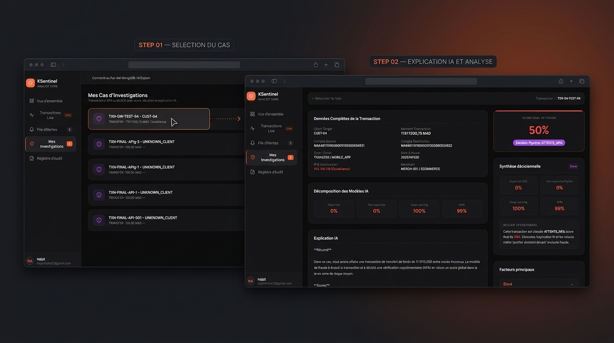
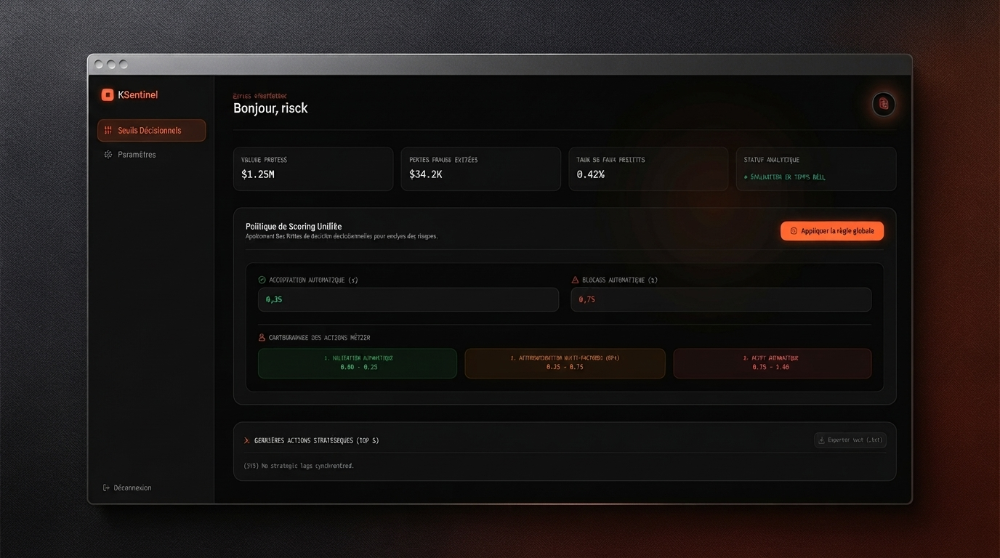
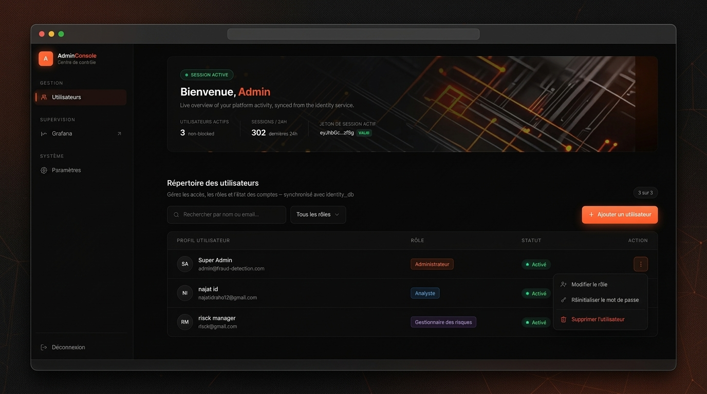

# KSentinel
### Intelligent Fraud Detection & Risk Scoring Platform

> **Every transaction tells a story. KSentinel helps identify suspicious activity through machine learning, risk assessment and explainable investigation.**

KSentinel is an academic project focused on the design of an intelligent platform for detecting potentially fraudulent financial transactions. It brings together several AI-based detection approaches and a risk-oriented workflow to support the analysis and investigation of suspicious activity.

This repository is the **public project showcase**. It presents the project scope, high-level architecture, AI approaches, selected experimental results and application interfaces. It does not contain the complete source code.

---

## Project at a glance

| | |
|---|---|
| **Project** | KSentinel — Fraud Detection & Risk Scoring |
| **Context** | Academic project (PFA 2025–2026) |
| **Institution** | ENIAD |
| **Field** | Computer Engineering, Artificial Intelligence |
| **Focus** | Fraud detection, anomaly detection, risk scoring, explainability |

## The challenge

Financial transaction fraud is difficult to detect because suspicious behaviour can be rare, evolve over time and differ from one customer or account to another. A single detection technique may fail to capture every type of suspicious pattern.

KSentinel explores a multi-approach strategy: combine supervised learning, anomaly detection, deep learning and graph-based learning, then use risk assessment to help organise the investigation of flagged transactions.

## Main capabilities

- **Transaction analysis** — process transaction data and identify potentially suspicious activity.
- **Multi-model detection** — explore complementary machine learning and deep learning techniques.
- **Risk assessment** — consolidate detection signals into a risk-oriented view.
- **Investigation support** — expose explanations and information that can help an analyst understand a flagged transaction.
- **Administration** — provide interfaces for platform administration.
- **Developer access** — expose a dedicated portal for API-oriented integration and access management.
- **Audit visibility** — support traceability through audit-oriented views.

## High-level architecture

The following diagram presents the main functional domains and their relationships. It is a **conceptual overview**, not a deployment diagram or a complete inventory of internal services.

### Functional domains

| Domain | Responsibility |
|---|---|
| **API & Access Management** | Entry points, authentication and controlled access |
| **Transaction Processing** | Transaction ingestion and preparation for analysis |
| **AI Detection Engine** | Execution of complementary fraud-detection approaches |
| **Risk Assessment** | Consolidation of model signals into a risk-oriented assessment |
| **Investigation & Explainability** | Presentation of suspicious activity and supporting explanations |
| **Audit & Reporting** | Traceability and operational visibility |

## AI approach

KSentinel explores four complementary detection approaches:

### 1. Supervised machine learning
- **Model:** LightGBM
- **Additional model:** XGBoost
- **Dataset used in the reported experiment:** IEEE-CIS Fraud Detection
- **Objective:** learn patterns from labelled transaction examples.

### 2. Unsupervised anomaly detection
- **Techniques:** Autoencoder and Isolation Forest
- **Dataset used in the reported experiment:** PaySim
- **Objective:** identify transactions that differ from learned or expected behaviour, including patterns that are not represented by labelled fraud examples.

### 3. Deep learning
- **Approaches:** Hybrid Autoencoder and TabNet
- **Dataset used in the reported experiment:** PaySim
- **Objective:** learn more complex representations of transaction data.

### 4. Graph neural networks
- **Approach:** Message Passing Graph Neural Network (GNN)
- **Dataset used in the reported experiment:** PaySim
- **Objective:** explore relationships between accounts and entities instead of analysing each transaction only as an isolated record.

### Risk-oriented decision support

The project explores the consolidation of detection outputs into a final risk score. The goal is to provide a more useful investigation signal than relying on a single model output.

The exact internal fusion formula, thresholds and implementation details are intentionally not disclosed in this public overview.

## Application preview

The following screenshots illustrate selected interfaces of the platform.

### Analyst dashboard

The analyst-oriented view brings together transaction and monitoring information to support the review of potentially suspicious activity.

### AI explanation and investigation

This view illustrates how the platform presents an AI-supported explanation for a suspicious transaction, helping make the detection result easier to interpret.

### Risk management

The risk-management interface presents the configuration and monitoring aspects associated with risk assessment.

### Administration

The administration interface provides platform-level management capabilities.

### Developer portal

The developer portal illustrates the API-oriented access and integration side of the platform.

### Authentication

The authentication screens illustrate the user entry flow.

## Experimental results

The following values are the results reported during the project's experiments. They are presented as **academic experimental results**, not as a production benchmark.

| Approach | Dataset / evaluation context | Reported AUC | Reported Recall |
|---|---|---:|---:|
| LightGBM | IEEE-CIS | 0.97 | 0.75 |
| Unsupervised Fusion | PaySim | 0.94 | 0.71 |
| Deep Learning | PaySim | 0.99 | 0.96 |
| GNN | PaySim | 0.99 | 0.73 |
| Final Score Fusion | Project evaluation | 0.98 | 0.79 |

**How to interpret these results**
- The experiments use different datasets and evaluation settings. Their metrics should therefore not be treated as a direct, like-for-like model ranking.
- PaySim is a synthetic mobile-money transaction dataset; results on it do not by themselves establish performance on real banking traffic.
- AUC and Recall describe different aspects of model performance. They should be interpreted alongside the dataset, class distribution, decision threshold and evaluation protocol.
- These figures reflect the reported project experiments and are not a guarantee of real-world fraud-detection performance.

## Technology stack

The project brings together technologies across backend development, AI, frontend interfaces, data storage and infrastructure.

| Area | Technologies |
|---|---|
| **Backend** | Java, Spring Boot, Spring Security, Python, FastAPI, Maven |
| **Machine Learning & AI** | LightGBM, XGBoost, TensorFlow, TabNet, Autoencoders, Isolation Forest, Graph Neural Networks, SHAP |
| **Frontend** | React, JavaScript, Tailwind CSS, Vite |
| **Streaming & Infrastructure** | Kafka, ZooKeeper, Docker |
| **Databases & Caching** | MongoDB, PostgreSQL, Redis |
| **Security & Observability** | JWT, OAuth 2.0, Prometheus, Grafana |

## Security and disclosure

This repository is intended to communicate the project's purpose and technical approach while keeping implementation details controlled.

- No credentials, access tokens, private keys or environment files are included.
- Internal service topology, sensitive configuration and detailed security implementation are not documented here.
- The complete source code is maintained separately and is not part of this public showcase.

## Possible next steps

Potential directions for further development include:
- validating the approaches on additional representative real-world datasets;
- evaluating model robustness under changing transaction patterns;
- improving model monitoring and the retraining workflow;
- enriching analyst feedback and investigation workflows;
- extending explainability and audit reporting.

These are improvement directions, not claims that all capabilities are already implemented.

## Project team

Developed as an academic project at **ENIAD** during the 2025–2026 academic year.

- **Youssra Hamidouche**
- **Najat Id Raho**
- **Ouissal Jouhari**

## Repository scope

This repository is the public-facing **KSentinel project showcase**: an overview of the problem, architecture, AI approaches, experimental results and selected application interfaces.

The complete source code is maintained in a separate private repository.

---

  <strong>Turning Transaction Intelligence into Real-Time Fraud Defense.</strong>

